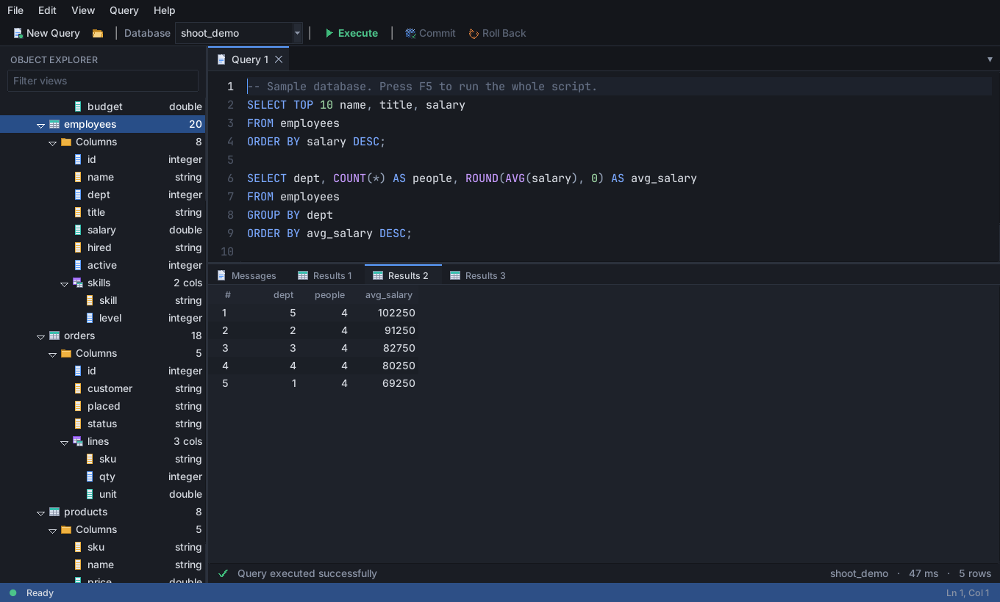

# MK Studio

A SQL-Server-Management-Studio-style workbench for **Metakit** databases, written entirely in
Tcl/Tk and shipped as a **starpack**: one self-contained executable (Tcl, Tk and Metakit
included) that you can copy anywhere and run.



## What it does

- **Object Explorer** - databases, views, columns; subviews nested; view filter; Enter or double-click opens a view
- **Edit Rows** - spreadsheet-style editing with type validation; **every row is there** (a 500,000-row view opens in
  ~0.1 s and scrolls instantly - no paging), sort by any column, **undo / redo** (edits, added rows, deleted rows including
  their subview contents), double-click a `> N rows` cell to open a subview
- **Bytes columns** - size and hex preview in the grid; a hex viewer with export, replace-from-file and clear
- **Add Column** - one click from the data editor, or in the **Designer** with rename, retype and drop (a renamed column keeps its position)
- **Query windows** - syntax highlighting, completion, Find, multiple result tabs, cancel, error underlining
- **Commit / Roll Back** - files are opened `-nocommit`: nothing reaches disk until you commit
- **Safety** - refuses files that aren't Metakit databases; read-only databases disable every write control;
  a second MK Studio asking to edit a database that is already open for editing is offered a read-only view instead
  (see *Crash safety and locking*)
- Dark, light and high-contrast themes; scales with display DPI; full keyboard operation (`F1` lists shortcuts)
- CSV import and export (export streams, so a whole big view can be exported), script save / open

More screenshots: [`docs/screenshots/`](docs/screenshots/) (all captured from the real app on real Metakit).

## The query language is pluggable

The UI never parses query text. It talks to one small seam, [`engine.tcl`](mkstudio.vfs/lib/app-mkstudio/engine.tcl),
which documents the exact contract (`::engine::parseScript`, `::engine::execute`, and the keyword / token /
cancel variables). `mkql.tcl` is a small built-in dialect so the app is usable on its own; a
standard-SQL-to-Metakit engine replaces it by redefining those two procs. The data grid and
designer use `store.tcl` directly and don't depend on the language at all.

    REAL_MK=1 tools/ext/tclkit-8.6.3-linux-x86_64 tests/engine_contract.tcl     # 38 checks against the contract

Edit the `stmts` array at the top of that test for your dialect and point it at your engine.

## Get it / build it

    tools/fetch-runtimes.sh             # download SHA1-verified tclkit runtimes into tools/ext/
    ./build.sh                          # Linux  -> dist/mkstudio-linux-x86_64
    ./build.sh all                      # + Windows (.exe)
    ./dist/mkstudio-linux-x86_64 [file.mk ...]

Binaries are not stored in git. `.github/workflows/build.yml` runs the whole test matrix on **Linux, Windows and two
macOS runners**, builds the starpacks and uploads them as artifacts (and attaches them to a release when you push a `v*` tag).
Wrapping needs no `sdx`: `tools/wrap.tcl` appends the application's Metakit payload to a runtime.

**macOS** has no usable prebuilt tclkit (the 2014 Tk 8.6.3 / 8.5.17 Mac builds crash on current macOS the first time a
window opens), so CI compiles a current Tcl/Tk 8.6 + Metakit kit with [KitCreator](https://kitcreator.rkeene.org/) on the Mac
runner (~8 min, cached), runs the tests with it, wraps the starpack with it and ad-hoc code-signs it
(Apple silicon refuses unsigned code). Download the Mac starpacks from the workflow's artifacts; `./build.sh macos`
explains how to do the same by hand.

Run from source (needs a Tk with Mk4tcl, e.g. a tclkit): `tclkit mkstudio.vfs/main.tcl [file.mk ...]`

## Verification

Every row below is something that was actually run; the CI badge-of-truth is the workflow itself.

| | status |
|---|---|
| All suites on **real Metakit** (Mk4tcl 2.4.9.7) | Linux, Tcl **8.6.3** and **8.5.17** - pass |
| **Windows** (`windows-latest`) | engine, contract, persistence, differential, crash-safety, grid and UI suites pass with the Windows tclkit; the built `.exe` launches and keeps running |
| **macOS** (`macos-15-intel` and `macos-latest`/Apple silicon) | the same suites pass with a KitCreator-built Tcl/Tk 8.6.16 (native Aqua); the starpack is wrapped, signed, payload-verified and launches |
| Real-world file (a tclkit's own boot database: subviews + binary columns) | opens, browses, hex view works |
| 500,000-row file | see the numbers below |
| Packaged Linux starpack | launches, opens a database, no errors |
| HiDPI | verified with Tk scaling 2.0 on Linux; Windows/macOS DPI behaviour depends on the runtime's manifest |
| Screen readers | **not supported**: Tk has no accessibility API. Keyboard operation, visible focus and a high-contrast theme are provided instead |

Tests (all in `tests/`):

- `lint.tcl` - no proc shadows a Tcl/Tk command, ASCII-only sources, no 8.6-only commands, no unguarded X11-only keysyms
- `test_mkql.tcl`, `engine_contract.tcl` - the built-in dialect and the engine contract
- `test_engine_diff.tcl` - **thousands of random queries** (predicates, expressions, aggregates, grouping, ordering,
  limits, DELETE/UPDATE) through the optimised executor and through the original simple one
  (`mkql_reference.tcl`); results must be identical, on the stand-in and on real Metakit under both Tcl versions
- `persist.tcl`, `test_crash_safety.tcl` - persistence and crash safety (next section)
- `test_grid.tcl` - the virtualised grid driven with real mouse and key events (100,000 rows in memory, a Metakit view,
  selection ranges, keyboard, sorting, editing in a scrolled grid, empty results)
- `gui_logic.tcl` - the UI logic incl. every popup menu and undo
- `verify_payload.tcl`, `smoke_starpack.sh`, `bench.tcl`, and `shoot.tcl` for screenshots

A pure-Tcl `mk::` stand-in (`mock_mk4tcl.tcl`) lets most of the suite also run without Metakit; it is test-only.

## Crash safety and locking

`tests/test_crash_safety.tcl` starts a child process that rewrites a database and commits in a tight loop, **kills it
(SIGKILL / `taskkill /F`) at awkward moments**, and checks the file afterwards: every view and row present, every row
internally consistent, and all rows from *one* commit generation (a half-applied commit would show a mixture). Variants
cover data commits and structural commits (add / drop a column). Negative controls prove the verifier can fail (it flags
a hand-made torn commit, a corrupted value and a truncated file). It also checks that uncommitted edits never touch the
file (byte-identical after a kill) and that Roll Back restores cells, added/deleted rows and structure exactly.

Result on every kill: **never a torn or corrupt file** - the file holds either the old commit or the new one. (In roughly a quarter to a half
of the kills the process died inside `commit`, so both the old and the new outcome are exercised.)

What this does **not** show: *power loss* or a failing disk. The tests kill the process, not the machine; the OS keeps
and flushes what was written. Metakit commits by appending, then switching the header, which is the right design for
that, but I cannot demonstrate durability across power failure here.

What it **did** find: Metakit does no locking. A second process that opens the file *while another commits* sometimes
sees a mixed or unreadable state (between under 1% and 12% of the probe's reads, depending on timing), and two writers can overwrite each other.
So MK Studio keeps an **advisory lock** `<file>.lock` (pid and host) next to every database it has open for editing:

- a second MK Studio asked to edit it gets *"Database in use ... Open Read-Only / Cancel"* (read-only is always allowed,
  with a warning that the other process's commits may show up half-written);
- a lock left behind by a crashed process is recognised (its pid is gone) and taken over, so a crash never locks you out;
- a lock from another machine (a network share) is respected, since its liveness can't be checked.

The lock only protects MK Studio from MK Studio - other programs that open the file ignore it. Read-only folders skip the lock.

## Performance and limits (500,000 rows, 29 MB, Linux)

| operation | now | was |
|---|---|---|
| open file, list views / layout | ~40 ms | |
| open a view in the editor / jump to any row | ~0.1 s / ~4 ms | 0.16 s for the first 5,000 rows only |
| `SELECT ... LIMIT 100` | ~10 ms | ~10 ms |
| `WHERE` on `=`, `<`, `<=`, `>`, `>=`, `BETWEEN`, `IN`, text `=` (pushed into Metakit) | 0.15-0.35 s | ~6.5 s |
| `WHERE` that can't be pushed (`LIKE`, expressions), full scan | ~2 s | ~6.5 s |
| `SELECT COUNT(*)` | ~1 ms | ~6 s |
| `SUM / MIN / MAX` over everything; `GROUP BY` | ~2.4 s; ~2.5 s | ~7 s; ~7.2 s |
| `ORDER BY <number column> ... LIMIT n` | ~1.2 s | ~11.5 s (41 s originally) |
| `ORDER BY <text column> ... LIMIT n` | ~2.9 s | |
| click a column header in the editor (sorts all 500,000 rows) | ~1.5 s | sorted the loaded page only |
| select all + copy 500,000 rows (34 MB) | ~10 s | |
| `UPDATE` 10,000 scattered rows of a string column | ~20 s | ~24 s |
| `DELETE` 10,000 scattered rows | ~32 s | |

The last two are **Metakit's own cost**: it keeps columns contiguous, so rewriting a variable-length string or deleting a
row shifts the rest of the column, and each write costs more the earlier it is in the view (deleting a *contiguous* run
is one call and fast). The app keeps the UI responsive, lets you cancel, skips writes that change nothing, and Roll Back
undoes a cancelled run.

How the speed-ups work, and their limits:

- **The grid is virtualised.** The treeview holds only the rows that fit in the window (about 30); scrolling re-labels
  them. Rows come from a data source that reads from Metakit on demand (a small cache), selection is a list of row
  *ranges* (so "select all" of 500,000 rows is free), and the scrollbar, wheel, keyboard and drag-selection are the grid's own.
  Scrolling is by whole rows, like the native treeview.
- **Filters are answered inside Metakit** (`mk::select`) when a top-level `AND` term has the right shape; the whole
  `WHERE` still runs on the surviving rows unless every term was pushed exactly. One visible consequence: a row that
  can only fail with an error (say `text * 2`) is never looked at if another term already ruled it out, so such a query
  may succeed where a plain scan would have stopped with an error.
- **These optimisations belong to the built-in dialect.** If you replace it with your own SQL engine (see below) its speed
  is yours to design; `store.tcl` offers `select`, `fetch`, `fetchAt` and `column` for exactly that. The grid and the data
  editor don't depend on the query language at all.

## Notes on Metakit

There is no NULL (it means the empty string). A view you drop stays listed by Metakit until commit, so views
with an empty layout are treated as gone. `mk::view layout` on a subview path returns the *top-level* layout, so
`store.tcl` walks the nested definition itself. `mk::row insert` only takes a count, so restoring a row inserts a
blank one and fills it. `mk::select -exact` on a *double* column compares the text ("7.0" is not "7"), so double
equality is expressed as a numeric range. `mk::select -sort` is not stable. Each of these is covered by a test.

## Layout

```
mkstudio.vfs/main.tcl                 entry point (starkit)
mkstudio.vfs/lib/app-mkstudio/
    store.tcl     the ONLY file that calls mk::*  (incl. the advisory write lock)
    engine.tcl    the query-language seam (documented contract)
    mkql.tcl      built-in stand-in dialect: parser, binder, value semantics
    mkplan.tcl    its fast execution path: pushdown, compiled expressions, streaming aggregates
    theme icons menus widgets grid editor explorer docs app
tests/  tools/  build.sh  .github/workflows/build.yml
```
